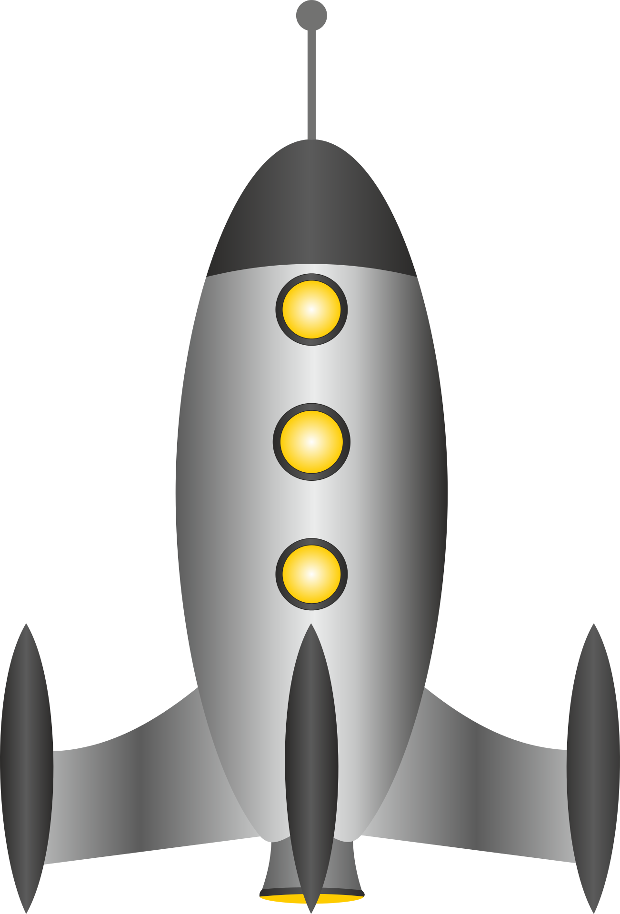
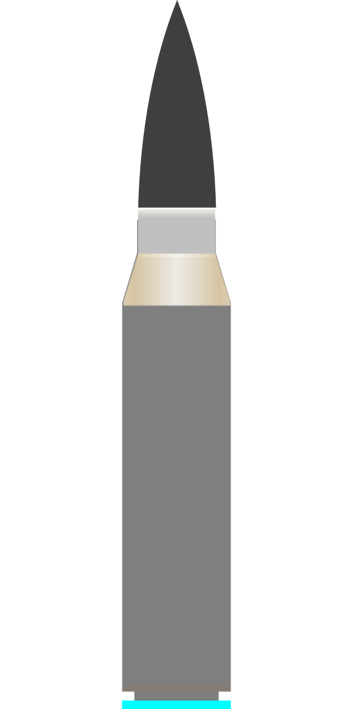

космический шутер, где игрок управляет ракетой,стреляющей в инопланетян.

<b>ИГРОК</b>
может двигать ракету влево и вправо с помощью _левой стрелки и правой стрелки_.Также нажатием _пробел_ стреляет из пушки

<b>ИНОПЛАНЕТЯНЕ<b>
летят вниз и задача игрока попадать в них пулей. При столкновении добавляется убийство в счетчик.

<b>ЕСЛИ<b>
вы убили 10 инопланетян, то вы выиграете,
<b>НО<b>
если вы пропустили 5, то проиграете.
___

<b>ДЛЯ СОЗДАНИЯ ИСПОЛНЯЕМОГО ФАЙЛА НУЖНО:<b>

1) введите pyinstaller --onefile<имя файла>.py,для создания исполняемого файла
  
2) далее соберите финальную папку с проектом в котором будет исполняемый файл из папки dist и все картинки и музыки, которые есть в игре.

ГОТОВО!!
